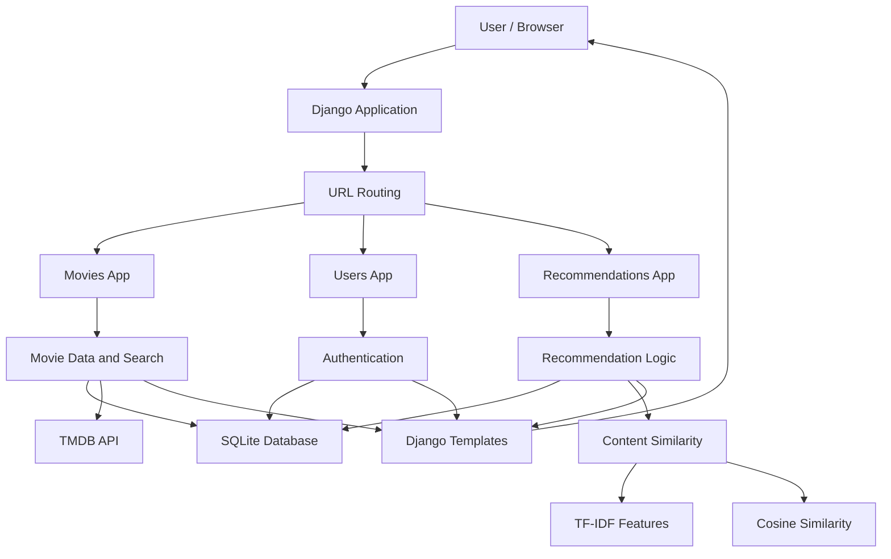
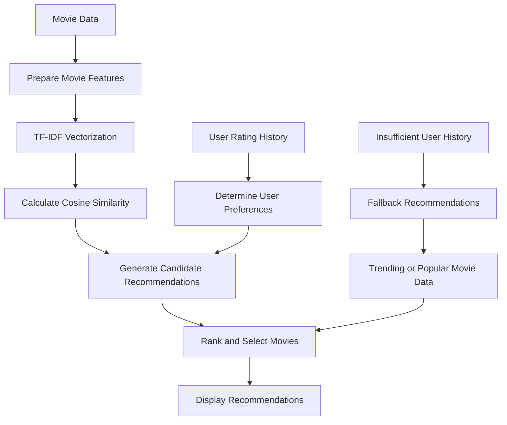

# 🎬 MoodFlix — AI-Driven Movie Recommendation Platform

<p align="center">
  <strong>Discover movies that match your taste, mood, and interests.</strong>
</p>

<p align="center">
  A Django-based movie recommendation platform that combines personalized recommendations, movie discovery, user ratings, and TMDB movie data to make finding your next favorite movie easier.
</p>

---

## 📌 Table of Contents

- [About the Project](#-about-the-project)
- [Problem Statement](#-problem-statement)
- [Objectives](#-objectives)
- [Features](#-features)
- [Technology Stack](#-technology-stack)
- [System Architecture](#-system-architecture)
- [Project Structure](#-project-structure)
- [How the Recommendation System Works](#-how-the-recommendation-system-works)
- [Getting Started](#-getting-started)
- [Environment Configuration](#-environment-configuration)
- [Running the Application](#-running-the-application)
- [Application Workflow](#-application-workflow)
- [Database](#-database)
- [Authentication and Security](#-authentication-and-security)
- [Troubleshooting](#-troubleshooting)
- [Future Enhancements](#-future-enhancements)
- [Contributing](#-contributing)
- [License](#-license)
- [Author](#-author)

---

## 🎯 About the Project

**MoodFlix** is a movie discovery and recommendation web application built with Django. It aims to improve the movie discovery experience by helping users find movies based on their interests, preferences, and rating history.

The application integrates with **The Movie Database (TMDB)** to retrieve movie-related information and uses a recommendation approach based on movie content and similarity. User interactions can help personalize recommendations, while fallback recommendations can assist users who have not yet provided enough preference data.

MoodFlix combines backend development, database management, external API integration, and machine learning concepts in a single web application.

### Why MoodFlix?

Traditional movie browsing often requires users to manually search through large collections of movies. MoodFlix aims to simplify this process by providing a centralized platform for discovering movies and exploring personalized recommendations.

The project's main focus is to make movie discovery more convenient, personalized, and accessible through a web interface.

---

## ❓ Problem Statement

With thousands of movies available across different genres and categories, users can find it difficult to decide what to watch.

A simple movie listing or search interface does not always account for an individual's interests or previous choices.

MoodFlix addresses this problem by combining movie information, content similarity, and user preference data to help users discover potentially relevant movies.

### Proposed Solution

MoodFlix provides:

- A web interface for exploring movies.
- Movie search and discovery using available movie data.
- A movie recommendation system based on content similarity.
- Personalized recommendations informed by user rating history.
- A fallback recommendation approach for users with limited interaction history.
- User authentication for accessing personalized application features.

---

## 🎯 Objectives

The main objectives of MoodFlix are:

1. Build a functional movie discovery platform using Django.
2. Integrate TMDB for movie-related data.
3. Explore content-based filtering for movie recommendations.
4. Use cosine similarity to identify movies with similar content representations.
5. Incorporate user ratings into the recommendation experience.
6. Handle the cold-start problem when users have limited rating history.
7. Organize the application using separate Django apps.
8. Store application data using SQLite during development.
9. Manage configuration using environment variables.
10. Create a foundation for future improvements to recommendation quality and user experience.

---

## ✨ Features

### 🎥 Movie Discovery

- Browse available movie information.
- Explore movie details retrieved from the configured data source.
- Search for movies by supported search criteria.
- Discover movies without manually browsing an entire catalogue.

### 🤖 Movie Recommendation System

- Content-based movie recommendation approach.
- TF-IDF vectorization for representing supported textual movie features.
- Cosine similarity for measuring similarity between movie representations.
- Personalized recommendations informed by user rating history.
- Fallback recommendations for users without sufficient preference data.

### 👤 User Management

- User authentication through Django's authentication system.
- Login and logout routing.
- User-specific application experiences where supported by the implemented views.
- A foundation for managing individual movie preferences.

### ⭐ Ratings and Personalization

- Use rating history as a source of user preference information.
- Incorporate available rating data into the recommendation process.
- Improve personalization as users interact with the platform.

*The exact rating controls, profile options, and recommendation pages depend on the implemented application views and templates.*

### 🌐 TMDB Integration

- Connect to The Movie Database API using an API key.
- Retrieve supported movie information from TMDB.
- Keep the API key outside the main source code through environment configuration.

### 🖥️ Django Web Application

- Modular project organization.
- Django template rendering.
- SQLite database for local development.
- Django REST Framework installed for API-related functionality.
- Environment-based configuration using `python-dotenv`.

---

## 🛠️ Technology Stack

| Technology | Purpose |
|---|---|
| Python | Main programming language |
| Django 6.0.5 | Web application framework |
| Django REST Framework | REST API development support |
| SQLite | Development database |
| TMDB API | External movie data |
| python-dotenv | Environment variable management |
| HTML and CSS | Web page structure and styling |
| JavaScript | Client-side interactivity, where implemented |
| Scikit-learn | Machine learning utilities, if used by the recommendation implementation |
| TF-IDF | Text feature representation in the described content-based approach |
| Cosine similarity | Movie similarity measurement |

**Note:** TF-IDF, cosine similarity, and Scikit-learn describe the recommendation approach documented for the project. Ensure that any required ML libraries are included in `requirements.txt` and installed in the development environment.

---

## 🏗️ System Architecture

MoodFlix follows a Django-based web application architecture. The Django project configuration connects the application modules, templates, database, authentication system, and external movie data source.

### High-Level Architecture



### Architecture Components

**1. Presentation Layer**

The browser displays pages rendered through Django templates, along with any CSS and JavaScript used by the interface.

**2. URL Routing Layer**

The main URL configuration is located in `MoodFlix/urls.py`. It directs incoming requests to the relevant application views.

**3. Movies Application**

The `movies` app is intended to handle movie-related functionality, such as movie browsing, search, and movie information.

**4. Users Application**

The `users` app provides a separate location for user-related functionality and authentication-related views.

**5. Recommendations Application**

The `recommendations` app separates recommendation-related functionality from other application components.

**6. Data Layer**

SQLite stores application data locally during development. Django's ORM can be used to interact with database models.

**7. External API Layer**

TMDB provides external movie information through API requests made by the application.

**8. Recommendation Layer**

The recommendation logic processes supported movie features and user preference data to identify relevant movie suggestions.

---

## 📁 Project Structure

The following is a logical representation of the repository based on the provided Django settings. Individual filenames inside each application may differ from this example.

```text
Mood_Flix/
│
├── manage.py
├── requirements.txt
├── .env
├── .gitignore
├── db.sqlite3
│
├── MoodFlix/
│   ├── __init__.py
│   ├── settings.py
│   ├── urls.py
│   ├── asgi.py
│   └── wsgi.py
│
├── movies/
│   ├── __init__.py
│   ├── admin.py
│   ├── apps.py
│   ├── models.py
│   ├── views.py
│   ├── urls.py
│   └── ...
│
├── users/
│   ├── __init__.py
│   ├── admin.py
│   ├── apps.py
│   ├── models.py
│   ├── views.py
│   ├── urls.py
│   └── ...
│
├── recommendations/
│   ├── __init__.py
│   ├── admin.py
│   ├── apps.py
│   ├── models.py
│   ├── views.py
│   ├── urls.py
│   └── ...
│
└── templates/
    └── ...
```

### Important Files and Directories

| File or directory | Responsibility |
|---|---|
| `manage.py` | Django command-line utility |
| `MoodFlix/settings.py` | Project configuration |
| `MoodFlix/urls.py` | Root URL configuration |
| `MoodFlix/wsgi.py` | WSGI deployment entry point |
| `MoodFlix/asgi.py` | ASGI deployment entry point |
| `movies/` | Movie-related application functionality |
| `users/` | User-related application functionality |
| `recommendations/` | Recommendation-related functionality |
| `templates/` | Project-level Django templates |
| `.env` | Local environment variables |
| `db.sqlite3` | Local SQLite database, created when needed |
| `requirements.txt` | Python dependency list |

---

## 🧠 How the Recommendation System Works

MoodFlix is designed around a content-based movie recommendation approach, with personalization informed by user rating history.

### 1. Movie Feature Representation

A movie can be represented through available textual attributes, such as its description, overview, genre, or other metadata.

The exact attributes depend on the data collected and the fields used by the recommendation implementation.

### 2. Text Preprocessing

Textual movie attributes may be combined and prepared for vectorization.

Preprocessing helps represent movie information consistently before similarity is calculated.

### 3. TF-IDF Vectorization

Term Frequency–Inverse Document Frequency (TF-IDF) converts textual information into numerical feature vectors.

It gives greater importance to terms that are informative within the collection while reducing the relative importance of terms that appear frequently across many documents.

Conceptually, a TF-IDF representation can be written as:

\[
\operatorname{TFIDF}(t,d)
=
\operatorname{TF}(t,d)
\times
\operatorname{IDF}(t)
\]

Where:

- \(t\) represents a term.
- \(d\) represents a movie document.
- \(\operatorname{TF}\) measures the term's frequency in a document.
- \(\operatorname{IDF}\) reflects how informative the term is across the collection.

### 4. Cosine Similarity

Cosine similarity compares two movie feature vectors by measuring the cosine of the angle between them.

\[
\operatorname{similarity}(A,B)
=
\frac{A\cdot B}{\|A\|\|B\|}
\]

A higher similarity score generally indicates that the two vectors point in more similar directions.

The recommendation process can use these scores to identify movies with similar content.

### 5. Personalized Recommendations

User rating history can provide information about a user's preferences.

The application can use this information to prioritize movies related to previously liked or highly rated content, depending on the implemented recommendation logic.

### 6. Cold-Start Handling

A new user may not have sufficient rating history for meaningful personalization.

A fallback approach can provide initial recommendations using available popularity or trending information from TMDB.

This gives users a starting point before sufficient preference data is available.

### Recommendation Workflow



*This diagram illustrates the recommendation approach conceptually. The actual ranking formula, data preprocessing, and fallback selection depend on the implementation in the repository.*

---

## 🚀 Getting Started

Follow these instructions to set up MoodFlix locally.

### Prerequisites

Install the following software before proceeding:

- Python compatible with Django 6.0.
- Git.
- A code editor such as Visual Studio Code or PyCharm.
- An internet connection for retrieving external movie data.
- A TMDB API key.

Django 6.0 requires Python 3.12 or newer. Check your Python version before installing the dependencies.

```bash
python --version
```

### Step 1: Clone the Repository

```bash
git clone https://github.com/Hitesh-XS/Mood_Flix.git
```

Navigate to the project directory:

```bash
cd Mood_Flix
```

### Step 2: Create a Virtual Environment

A virtual environment isolates project dependencies from other Python projects.

**Windows — PowerShell**

```powershell
python -m venv .venv
```

Activate the environment:

```powershell
.\.venv\Scripts\Activate.ps1
```

If PowerShell prevents activation, you can use Command Prompt instead:

```cmd
.venv\Scripts\activate.bat
```

**Linux or macOS**

```bash
python3 -m venv .venv
source .venv/bin/activate
```

### Step 3: Install Dependencies

Upgrade pip:

```bash
python -m pip install --upgrade pip
```

Install the dependencies listed in the repository:

```bash
pip install -r requirements.txt
```

If the recommendation implementation imports additional libraries that are missing from `requirements.txt`, install those dependencies and update the file accordingly.

### Step 4: Configure Environment Variables

Create a `.env` file in the same directory as `manage.py`.

```env
TMDB_API_KEY=your_tmdb_api_key_here
```

Replace the placeholder with your own TMDB API key.

The settings file loads this configuration using `python-dotenv`.

### Step 5: Apply Database Migrations

Run:

```bash
python manage.py migrate
```

This creates or updates the database tables required by Django and the application's installed models.

If you have modified application models and need to create new migration files, run:

```bash
python manage.py makemigrations
python manage.py migrate
```

### Step 6: Create an Administrator Account (Optional)

To access the Django administration interface:

```bash
python manage.py createsuperuser
```

Follow the prompts to create your account.

### Step 7: Start the Development Server

```bash
python manage.py runserver
```

Open the following address in your browser:

**http://127.0.0.1:8000/**

The exact landing page and available routes depend on the project's URL configuration.

---

## 🔐 Environment Configuration

MoodFlix uses `python-dotenv` to load environment variables from a `.env` file located in the project root.

The provided Django settings use:

```python
SETTINGS_DIR = Path(__file__).resolve().parent
BASE_DIR = SETTINGS_DIR.parent

load_dotenv(BASE_DIR / ".env")

TMDB_API_KEY = os.getenv("TMDB_API_KEY")
```

This allows the application to read the TMDB API key without placing the key directly in the API integration code.

### Required Environment Variable

| Variable | Purpose |
|---|---|
| `TMDB_API_KEY` | API key used for supported TMDB requests |

### Security Recommendations

- Never commit your `.env` file.
- Add `.env` to `.gitignore`.
- Do not print secret values or API keys in application logs.
- Keep production secrets separate from development configuration.
- Use a strong, private Django `SECRET_KEY`.
- Disable debug mode before production deployment.

A suitable `.gitignore` should include entries similar to:

```gitignore
.env
.venv/
__pycache__/
*.py[cod]
db.sqlite3
staticfiles/
```

Adjust these entries to match your actual project workflow. Do not ignore files required by your deployment or version-control process.

---

## ▶️ Running the Application

After completing the installation steps, start the Django development server:

```bash
python manage.py runserver
```

Django normally serves the local application at:

```text
http://127.0.0.1:8000/
```

### Django Administration

If you created a superuser, open:

```text
http://127.0.0.1:8000/admin/
```

Log in using the administrator credentials.

Whether application-specific models appear in the admin interface depends on how they are registered in each app's `admin.py`.

### Authentication Redirects

The current project configuration defines the following routing names:

```python
LOGIN_URL = 'login'
LOGIN_REDIRECT_URL = 'home'
LOGOUT_REDIRECT_URL = 'login'
```

These settings tell Django which named URL to use for login redirection, successful login redirection, and logout redirection. The corresponding URL names must exist in the project's URL configuration.

---

## 🔄 Application Workflow

A typical user workflow for MoodFlix can be represented as follows:

1. **Open the application:** The user visits the MoodFlix website.
2. **Authenticate:** The user logs in when authentication is required.
3. **Discover movies:** The user explores available movie information.
4. **Search:** The user searches for a movie using supported search functionality.
5. **Interact with movies:** The user provides ratings or other supported preference information.
6. **Generate recommendations:** The recommendation component uses available movie features and preference data.
7. **Handle new users:** If preference history is insufficient, the application can use its fallback recommendation approach.
8. **Explore suggestions:** The user reviews the resulting movie recommendations.

The exact screens and steps available depend on the implemented views, templates, and URL patterns.

---

## 🗄️ Database

MoodFlix currently uses **SQLite** for development.

The database is configured in `MoodFlix/settings.py`:

```python
DATABASES = {
    'default': {
        'ENGINE': 'django.db.backends.sqlite3',
        'NAME': BASE_DIR / 'db.sqlite3',
    }
}
```

### Why SQLite?

SQLite is convenient for local development because it does not require a separate database server. It is suitable for prototyping and many small applications.

### Database Management

Apply migrations:

```bash
python manage.py migrate
```

Create migration files after model changes:

```bash
python manage.py makemigrations
```

Inspect migration status:

```bash
python manage.py showmigrations
```

Open the Django shell:

```bash
python manage.py shell
```

### Production Considerations

For a production deployment with greater concurrency or operational requirements, consider a database such as PostgreSQL.

Any database migration should include appropriate configuration changes, backups, and migration testing.

---

## 🔒 Authentication and Security

MoodFlix uses Django's authentication and middleware infrastructure.

The provided settings include:

- Django authentication middleware.
- Session middleware.
- CSRF protection middleware.
- Django password validators.
- Login and logout redirect settings.

### Current Development Configuration

The provided settings use:

```python
DEBUG = True
ALLOWED_HOSTS = []
```

These values are intended for local development, not a publicly deployed production environment.

### Before Deployment

Review the following items:

- Set `DEBUG = False`.
- Configure `ALLOWED_HOSTS` for the actual deployment domain.
- Load `SECRET_KEY` from a secure environment variable.
- Keep API keys private.
- Use HTTPS in production.
- Review cookie security settings.
- Keep dependencies updated.
- Verify that authentication and authorization checks protect private functionality.
- Review Django's deployment checklist.

Official documentation: [Django deployment checklist](https://docs.djangoproject.com/en/6.0/howto/deployment/checklist/).

---

## 🧪 Testing and Validation

Django provides built-in commands for checking the project's configuration and running tests.

### Check Project Configuration

```bash
python manage.py check
```

### Run Tests

```bash
python manage.py test
```

### Validate Migrations

```bash
python manage.py makemigrations --check
python manage.py migrate
```

### Verify Dependency Installation

```bash
pip check
```

These commands help identify configuration errors, failing tests, missing dependencies, and migration issues. Their successful execution depends on the current repository configuration and test suite.

---

## 🐛 Troubleshooting

### 1. `ModuleNotFoundError`

**Possible cause:** A required dependency is missing or the wrong Python environment is active.

**Solution:**

```bash
python -m pip install -r requirements.txt
python -m pip check
```

Verify that the virtual environment is activated.

### 2. TMDB API Key Is Missing

**Possible causes:**

- The `.env` file is missing.
- The file is not in the project root.
- The variable name is incorrect.
- The API key is invalid.

**Solution:**

Confirm that `.env` is beside `manage.py` and contains:

```env
TMDB_API_KEY=your_tmdb_api_key_here
```

Restart the development server after changing environment configuration.

Avoid printing the API key itself while debugging. Check whether the value exists without exposing it:

```python
print("TMDB key configured:", bool(TMDB_API_KEY))
```

### 3. Database or Migration Errors

**Solution:**

```bash
python manage.py showmigrations
python manage.py makemigrations
python manage.py migrate
```

Do not delete the database to resolve migration problems unless you understand the consequences and have backed up any important data.

### 4. `NoReverseMatch`

**Possible cause:** A template or redirect refers to a URL name that is not registered.

**Solution:**

Check `MoodFlix/urls.py`, application URL configurations, and the names used by templates and redirect settings.

In particular, verify the URL names `login` and `home`.

### 5. Port Already in Use

If port 8000 is occupied, start Django on another port:

```bash
python manage.py runserver 8001
```

Then visit:

```text
http://127.0.0.1:8001/
```

### 6. Recommendations Are Not Personalized

**Possible causes:**

- No rating history is available.
- Movie feature data is incomplete.
- The recommendation component has insufficient input data.
- Required machine learning dependencies are missing.

**Solution:**

Check the recommendation implementation, movie metadata, user preference records, and dependency configuration. If the project supports a fallback mechanism, verify that it can provide suggestions without rating history.

---

## 🚧 Future Enhancements

Potential improvements for MoodFlix include:

- [ ] Add more advanced collaborative filtering.
- [ ] Explore hybrid recommendation approaches combining content and user behavior.
- [ ] Improve recommendations using additional movie metadata.
- [ ] Add richer movie filtering and sorting options.
- [ ] Enhance user profiles and preference management.
- [ ] Improve recommendation evaluation using suitable metrics.
- [ ] Add automated tests for movie discovery and recommendation logic.
- [ ] Improve caching for frequently requested external movie data.
- [ ] Add pagination and performance optimizations.
- [ ] Improve accessibility and responsive design.
- [ ] Add deployment configuration and continuous integration.
- [ ] Evaluate PostgreSQL for production deployment.

These are possible future directions rather than claims that the features are already implemented.

---

## 🤝 Contributing

Contributions, suggestions, and bug reports are welcome.

To contribute:

1. Fork the repository.
2. Clone your fork.
3. Create a feature branch.
4. Implement your changes.
5. Run the available checks and tests.
6. Commit your changes with a clear message.
7. Push your branch.
8. Open a pull request describing the changes.

Example:

```bash
git checkout -b feature/your-feature
```

After making changes:

```bash
python manage.py check
python manage.py test
```

Please keep contributions focused, document meaningful changes, and avoid committing secrets or local database files.

---

## 📄 License

No license is specified in this README.

If you intend to distribute the project as open source, add a suitable `LICENSE` file to the repository and update this section accordingly.

---

## 👨‍💻 Author

**Hitesh-XS**

- GitHub: [https://github.com/Hitesh-XS](https://github.com/Hitesh-XS)
- Project Repository: [Mood_Flix](https://github.com/Hitesh-XS/Mood_Flix)

---

<p align="center">
  <strong>🎬 MoodFlix — Find your next favorite movie.</strong>
</p>

<p align="center">
  Built with Python, Django, and a passion for personalized movie discovery.
</p>
